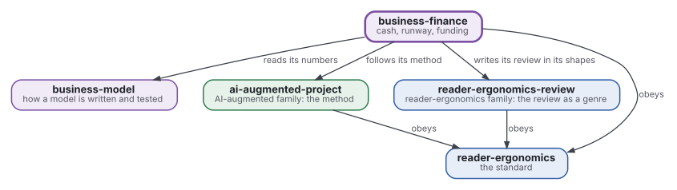
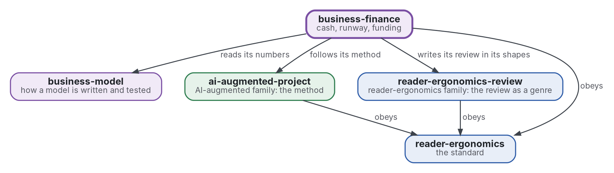

# Finance et autonomie

[](https://github.com/Tewf/business-finance/actions/workflows/checks.yml)
[](https://tewf.github.io/business-finance/)

La trésorerie, l'**autonomie de trésorerie**, le seuil de rentabilité et les scénarios d'une petite entreprise, et l'économie du financement (capital, subventions, dette, autofinancement). Un programme calcule l'autonomie et le seuil à partir des nombres d'un modèle.

Cette page en anglais : [README.md](README.md). Les deux versions suivent le même état.

> **État (2026-11-04) :** mis en place ; rien n'est encore écrit au-delà du périmètre. Le premier travail est une revue
> de littérature, non commencée. Le nom est provisoire jusqu'à ce que la première étape de cette revue dise comment le
> domaine nomme la chose. Ce n'est ni une norme officielle, ni une étude relue par des pairs, ni un résultat nouveau.
>
> **Comment il est fait :** avec Claude, un assistant IA d'Anthropic, sous la direction du mainteneur, comme
> reader-ergonomics. Les corrections sont bienvenues sous forme d'issues.

## Où il se place



<details>
<summary>Graphviz source</summary>



</details>

- **Il lit les nombres de [business-model](https://github.com/Tewf/business-model)** : le modèle possède l'économie unitaire, ce dépôt possède ce qu'elle fait à la trésorerie dans le temps.
- **Sa méthode est celle d'[ai-augmented-project](https://github.com/Tewf/ai-augmented-project)** : cadrer, revoir, fixer une référence et planifier, et les registres des décisions et des valeurs provisoires. Il ne dépend pas des autres parties de ce dépôt.
- **Il écrit sa revue dans les formes de [reader-ergonomics-review](https://github.com/Tewf/reader-ergonomics-review)**, la revue comme genre ; les formes sont celles de ce dépôt.
- **Il obéit à [reader-ergonomics](https://github.com/Tewf/reader-ergonomics/blob/2e5b6f0c3e67d2dc8195a63cf882d46170e79a5a/standard.md)** (v1.21.0) et exécute ses vérifications en CI.
- **Il ne pointe que vers le bas.** La carte de la famille est [business](https://github.com/Tewf/business). Une entreprise n'apparaît ici que comme exemple, jamais comme sujet.

## Périmètre

| | Quoi | Pourquoi |
|---|---|---|
| dedans | la trésorerie, l'autonomie et le seuil de rentabilité : combien de temps l'argent dure et à quel volume les coûts sont couverts | une entreprise meurt quand l'argent finit, pas quand le modèle a tort, et les deux dates diffèrent |
| dedans | les scénarios : bas, de base et haut, chacun nommant le seul nombre qu'il change | une fourchette avec ses causes en dit plus qu'une prévision unique |
| dedans | la discipline de coût par événement : rien n'est payé avant son événement, donc un coût est choisi gratuit jusqu'à l'événement qui le déclenche | quand le revenu vient longtemps après l'immatriculation, l'ordre des coûts décide de la durée de la trésorerie |
| dedans | le plan en trois états : avant le lancement, au lancement et à l'échelle, avec l'événement qui fait passer de l'un à l'autre | un plan avec des états et des événements se vérifie ; un plan à dates seules non |
| dedans | l'économie du financement : capital, subventions, dette et autofinancement, ce que chacun coûte et ce qu'il demande | chaque source d'argent prend quelque chose, et une petite entreprise doit savoir quoi avant de demander |
| dedans | les rendements mesurés des subventions et des accélérateurs | le conseil d'en chercher est courant et l'effet mesuré est une question, non un acquis |
| dedans | un programme qui calcule l'autonomie et le seuil de rentabilité à partir des nombres d'un modèle | un calcul fait à la main dans un tableur cache ses erreurs |
| plus tard | les règles fiscales et comptables par pays | elles changent avec le lieu et la forme juridique, et la première passe reste générale |
| dehors | l'économie unitaire et les parties d'un modèle | [business-model](https://github.com/Tewf/business-model) |

## Le premier travail : une revue de littérature

Non commencée. Elle suit l'ordre d'une revue de thèse, et elle est finie quand elle peut nommer la référence.

1. **Cadrer :** le problème en une phrase, et comment chaque domaine le nomme. Pistes à vérifier : les manuels de finance d'entreprise écrits pour les petites firmes. La littérature du financement des jeunes entreprises. Les rendements mesurés des subventions publiques et des accélérateurs. L'autonomie de trésorerie telle que la définissent les praticiens (grise). Le dépôt peut être renommé alors.
2. **Revue :** chaque nom, cherché par son nom académique, son acronyme et son auteur ; les synthèses d'abord.
   - l'autonomie, la consommation de trésorerie et le seuil de rentabilité tels que les définissent les textes de finance, et où les praticiens emploient les mots autrement ;
   - le choix entre capital, subventions, dette et autofinancement, d'après la théorie du financement et des résultats mesurés ;
   - les études de subventions et d'accélérateurs qui estiment un effet, leurs plans lus dans la source ;
   - des programmes de référence pour une prévision de trésorerie, trouvés sous le nom de leurs auteurs avant d'en écrire un.
3. **État de l'art, et le dossier contre.**
4. **Positionnement :** ce que ce dépôt demande et que le domaine ne répond pas déjà.
5. **Référence :** un programme d'autonomie et de seuil de rentabilité à partir des nombres d'un modèle, exécuté sur un plan en trois états et comparé à une prévision de tableur, qui est la pratique.

## Questions auxquelles la revue doit répondre

- **Autonomie.** Combien de temps la trésorerie dure-t-elle quand le premier revenu arrive longtemps après l'immatriculation, et quels coûts peuvent attendre leur événement ?
- **Financement.** Que coûte chaque source de financement à une petite entreprise, et que disent les rendements mesurés des subventions et des accélérateurs ?
- **Scénarios.** Combien de scénarios faut-il à un plan, et quels nombres chacun doit-il déplacer ?
- **Le programme.** Quels défauts d'une prévision de trésorerie un programme trouve-t-il à partir des seuls nombres du modèle ?

## Vérifier

```sh
git clone https://github.com/Tewf/reader-ergonomics
python3 reader-ergonomics/checks/run.py chemin/vers/ce/depot
```

La CI exécute les mêmes vérifications à chaque push, et une exécution échoue à la première erreur
([checks.yml](https://github.com/Tewf/business-finance/blob/master/.github/workflows/checks.yml)). Chaque push sur
master construit aussi le site, [tewf.github.io/business-finance](https://tewf.github.io/business-finance/)
([pages.yml](https://github.com/Tewf/business-finance/blob/master/.github/workflows/pages.yml)).

## Contenu

| Partie | Résumé |
|---|---|
| [decisions](decisions/) | une fiche par choix qui façonne ce dépôt, chacune ouvrant sur la décision en une phrase |

## Licence

Code sous [Apache License 2.0](LICENSE) ; prose sous [CC BY 4.0](LICENSES/CC-BY-4.0.txt). Réutilisez-le comme vous le
souhaitez, en créditant ce dépôt ; [CITATION.cff](CITATION.cff) donne une citation si besoin.
