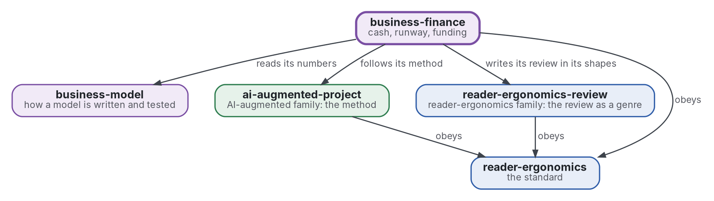

# Finance et autonomie

[](https://github.com/Tewf/business-finance/actions/workflows/checks.yml)
[](https://tewf.github.io/business-finance/)

La trésorerie, l'**autonomie de trésorerie**, le seuil de rentabilité et les scénarios d'une petite entreprise, et l'économie du financement (capital, subventions, dette, autofinancement). Un programme calcule l'autonomie et le seuil à partir des nombres d'un modèle.

Cette page en anglais : [README.md](README.md). Les deux versions suivent le même état.

> **État (2026-11-04) :** la première revue est écrite, 32 sources, et se termine sur la référence B1. Le programme
> `checks/local/runway.py` tourne sur un jeu d'essai de valeurs inventées. Le nom est gardé pour l'instant ; le cadrage
> de la revue dit que le domaine nomme la chose finance entrepreneuriale. Ce n'est ni une norme officielle, ni une
> étude relue par des pairs, ni un résultat nouveau.
>
> **Comment il est fait :** avec Claude, un assistant IA d'Anthropic, sous la direction du mainteneur, comme
> reader-ergonomics. Les corrections sont bienvenues sous forme d'issues.

## Où il se place


<details>
<summary>Graphviz source</summary>



</details>

- **Il lit les nombres de [business-model](https://github.com/Tewf/business-model)** : le modèle possède l'économie unitaire, ce dépôt possède ce qu'elle fait à la trésorerie dans le temps.
- **Sa méthode est celle d'[ai-augmented-project](https://github.com/Tewf/ai-augmented-project)** : cadrer, revoir, fixer une référence et planifier, et les registres des décisions et des valeurs provisoires. Il ne dépend pas des autres parties de ce dépôt.
- **Il écrit sa revue dans les formes de [reader-ergonomics-review](https://github.com/Tewf/reader-ergonomics-review)**, la revue comme genre ; les formes sont celles de ce dépôt.
- **Il obéit à [reader-ergonomics](https://github.com/Tewf/reader-ergonomics/blob/2e5b6f0c3e67d2dc8195a63cf882d46170e79a5a/standard.md)** (v1.21.0) et exécute ses vérifications en CI.
- **Il ne pointe que vers le bas.** La carte de la famille est [business](https://github.com/Tewf/business). Une entreprise n'apparaît ici que comme exemple, jamais comme sujet.

## Périmètre

| | Quoi | Pourquoi |
|---|---|---|
| dedans | la trésorerie, l'autonomie et le seuil de rentabilité : combien de temps l'argent dure et à quel volume les coûts sont couverts | une entreprise meurt quand l'argent finit, pas quand le modèle a tort, et les deux dates diffèrent |
| dedans | les scénarios : bas, de base et haut, chacun nommant le seul nombre qu'il change | une fourchette avec ses causes en dit plus qu'une prévision unique |
| dedans | la discipline de coût par événement : rien n'est payé avant son événement, donc un coût est choisi gratuit jusqu'à l'événement qui le déclenche | quand le revenu vient longtemps après l'immatriculation, l'ordre des coûts décide de la durée de la trésorerie |
| dedans | le plan en trois états : avant le lancement, au lancement et à l'échelle, avec l'événement qui fait passer de l'un à l'autre | un plan avec des états et des événements se vérifie ; un plan à dates seules non |
| dedans | l'économie du financement : capital, subventions, dette et autofinancement, ce que chacun coûte et ce qu'il demande | chaque source d'argent prend quelque chose, et une petite entreprise doit savoir quoi avant de demander |
| dedans | les rendements mesurés des subventions et des accélérateurs | le conseil d'en chercher est courant et l'effet mesuré est une question, non un acquis |
| dedans | un programme qui calcule l'autonomie et le seuil de rentabilité à partir des nombres d'un modèle | un calcul fait à la main dans un tableur cache ses erreurs |
| plus tard | les règles fiscales et comptables par pays | elles changent avec le lieu et la forme juridique, et la première passe reste générale |
| dehors | l'économie unitaire et les parties d'un modèle | [business-model](https://github.com/Tewf/business-model) |

## Ce que la revue a trouvé

La revue est dans [evidence/finance-runway](evidence/finance-runway/), une première passe de 32 sources. Chaque chiffre y
est lu dans un résumé et marqué (secondary) ; la revue est en anglais. Les termes (consommation brute, plan en trois
événements, « rien n'est payé avant son événement ») sont définis dans le [cadrage](evidence/finance-runway/frame.md).

- **L'autonomie de trésorerie est un mot de praticiens.** Aucune source formelle ne la définit. La consommation est
  définie par le guide d'un investisseur. Le seuil de rentabilité l'est par les manuels de comptabilité de gestion.
- **L'argent qui manque est la dernière cause, non la première.** Sur 385 entreprises financées par du capital-risque
  et disparues, dont la raison est connue, 70 % citent l'épuisement du capital. Le producteur l'appelle la cause finale.
- **Subventions et accélérateurs ont des effets mesurés mitigés.** Une aide SBIR double à peu près la chance d'un
  capital-risque ultérieur. Cinquante-deux évaluations de subventions à la R&D ne montrent pas d'additionnalité
  substantielle. La formation des accélérateurs a aidé ; les services seuls non.
- **Les prévisions sont optimistes, et une moyenne cache la fourchette.** Trois scénarios, chacun déplaçant un nombre
  nommé, sont le minimum que les données soutiennent.

## La référence

**B1 est l'autonomie de tableur :** la trésorerie divisée par la consommation brute du mois 0, chaque coût courant
depuis le début, un seul scénario. C'est la pratique du domaine, écrite dans
[baseline](evidence/finance-runway/baseline.md). Le programme lui est comparé : sur le jeu d'essai, B1 donne 66,7 mois et
le modèle par événements en donne 12.

## Le programme

`checks/local/runway.py` lit un petit fichier toml des nombres d'un modèle et affiche :

- l'autonomie, par événements et par la règle du tableur ;
- le seuil de rentabilité : le premier mois où le flux d'exploitation est au moins nul, et les unités par mois qui couvrent les coûts ;
- les trois états (avant le lancement, au lancement, à l'échelle) et l'événement qui ouvre chacun ;
- une ligne par scénario, chacun nommant le seul nombre qu'il change ;
- les défauts trouvés à partir des seuls nombres, comme un coût sans événement ou une trésorerie qui finit avant un événement ;
- chaque valeur non déclarée mesurée, étiquetée PROVISIONAL.

```sh
python3 checks/local/runway.py checks/local/three-states.toml
python3 -m unittest discover -s checks
```

Le jeu d'essai contient des valeurs inventées pour une entreprise fictive ; ce ne sont pas des données d'une entreprise réelle.

## Questions auxquelles la revue répond

- **Autonomie.** Combien de temps la trésorerie dure-t-elle quand le premier revenu arrive longtemps après l'immatriculation, et quels coûts peuvent attendre leur événement ?
- **Financement.** Que coûte chaque source de financement à une petite entreprise, et que disent les rendements mesurés des subventions et des accélérateurs ?
- **Scénarios.** Combien de scénarios faut-il à un plan, et quels nombres chacun doit-il déplacer ?
- **Le programme.** Quels défauts d'une prévision de trésorerie un programme trouve-t-il à partir des seuls nombres du modèle ?

## Vérifier

```sh
git clone https://github.com/Tewf/reader-ergonomics
python3 reader-ergonomics/checks/run.py chemin/vers/ce/depot
```

La CI exécute les mêmes vérifications à chaque push, et une exécution échoue à la première erreur
([checks.yml](https://github.com/Tewf/business-finance/blob/master/.github/workflows/checks.yml)). Chaque push sur
master construit aussi le site, [tewf.github.io/business-finance](https://tewf.github.io/business-finance/)
([pages.yml](https://github.com/Tewf/business-finance/blob/master/.github/workflows/pages.yml)).

## Contenu

| Partie | Résumé |
|---|---|
| [evidence](evidence/) | la revue : 32 sources, cinq étapes, terminée sur la référence B1 |
| [checks/local](checks/local/) | `runway.py`, le programme, et son jeu d'essai de valeurs inventées ; tests dans `checks/test_runway.py` |
| [decisions](decisions/) | une fiche par choix qui façonne ce dépôt, chacune ouvrant sur la décision en une phrase |

## Licence

Code sous [Apache License 2.0](LICENSE) ; prose sous [CC BY 4.0](LICENSES/CC-BY-4.0.txt). Réutilisez-le comme vous le
souhaitez, en créditant ce dépôt ; [CITATION.cff](CITATION.cff) donne une citation si besoin.
