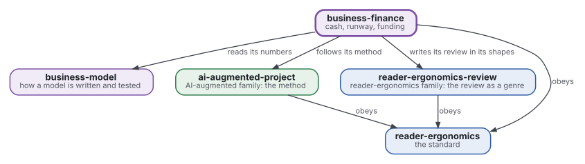
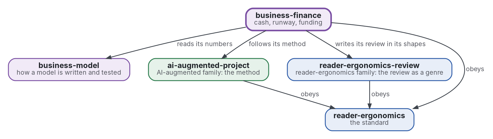

# Finance and runway

[](https://github.com/Tewf/business-finance/actions/workflows/checks.yml)
[](https://tewf.github.io/business-finance/)

Cash, **runway**, break-even and scenarios for a small venture, the economics of funding (equity, grants, debt, bootstrapping), and a program that computes runway and break-even from a model's numbers.

This page in French: [README.fr.md](README.fr.md).

> **Status (2026-11-04):** set up; nothing is written yet beyond the scope. The first job is a literature review, not
> started. The name is provisional until that review's first step says what the field calls this. It is not an
> official standard, not a peer-reviewed study and not a new result.
>
> **How it is made:** with Claude, an AI assistant by Anthropic, under the maintainer's direction, the way
> reader-ergonomics was made. Corrections are welcome as issues.

## Where it sits



<details>
<summary>Graphviz source</summary>



</details>

- **It reads the numbers of [business-model](https://github.com/Tewf/business-model)**: the model owns the unit economics, this repository owns what they do to cash over time.
- **Its method is [ai-augmented-project](https://github.com/Tewf/ai-augmented-project)'s**: scope, review, baseline and plan, and the registers of decisions and of provisional values. It does not depend on that repository's other parts.
- **It writes its review in the shapes of [reader-ergonomics-review](https://github.com/Tewf/reader-ergonomics-review)**, the review as a genre; the shapes are that repository's.
- **It obeys [reader-ergonomics](https://github.com/Tewf/reader-ergonomics/blob/2e5b6f0c3e67d2dc8195a63cf882d46170e79a5a/standard.md)** (v1.21.0) and runs its checks in CI.
- **It links down only.** The family's map is [business](https://github.com/Tewf/business). A venture appears here as an example, never as the subject.

## Scope

| | What | Why |
|---|---|---|
| in | cash, runway and break-even: how long cash lasts and at what volume costs are covered | a venture fails when cash ends, not when the model is wrong, and the two dates differ |
| in | scenarios: low, base and high, each naming the one number it changes | a range with its causes tells more than a single forecast |
| in | event-driven cost discipline: nothing is paid before its event, so a cost is chosen to be free until the event that triggers it | when revenue comes long after registration, the order of costs decides how long cash lasts |
| in | the three-state plan: before launch, at launch and at scale, with the event that moves the venture from one state to the next | a plan with states and events can be checked; a plan with dates alone cannot |
| in | the economics of funding: equity, grants, debt and bootstrapping, what each costs and what each asks | each source of money takes something, and a small venture should know what before it asks |
| in | the measured returns of grants and accelerators | advice to seek them is common and the measured effect is a question, not a given |
| in | a program that computes runway and break-even from a model's numbers | arithmetic done by hand in a spreadsheet hides its errors |
| later | tax and accounting rules by country | they change with the place and the legal form, and the first pass stays general |
| out | unit economics and the parts of a model | [business-model](https://github.com/Tewf/business-model) |

## The first job: a literature review

Not started. It follows the order of a thesis review, and it is finished when it can name the baseline.

1. **Frame:** the problem in one sentence, and what each field calls it. Leads to verify: corporate finance texts written for small firms, venture financing literature, the measured returns of public grants and of accelerators, and runway as practitioners define it (grey). The repository may be renamed then.
2. **Review:** each name, searched by its academic name, its acronym and its author; surveys first.
   - runway, burn and break-even as finance texts define them, and where practitioners use the words differently;
   - the choice between equity, grants, debt and bootstrapping, from financing theory and from measured outcomes;
   - studies of grants and accelerators that estimate an effect, with their designs read in the source;
   - reference programs for a cash forecast, found under the authors' names before one is written.
3. **State of the art, and the case against.**
4. **Position:** what this repository asks that the field does not already answer.
5. **Baseline:** a program for runway and break-even from a model's numbers, run on a plan in three states and compared with a spreadsheet forecast as the practice.

## Questions the review must answer

- **Runway.** How long does cash last when first revenue arrives long after registration, and which costs can wait for their event?
- **Funding.** What does each source of funding cost a small venture, and what do measured returns say of grants and accelerators?
- **Scenarios.** How many scenarios does a plan need, and which numbers must each one move?
- **The program.** Which faults in a cash forecast can a program find from the model's numbers alone?

## Check it

```sh
git clone https://github.com/Tewf/reader-ergonomics
python3 reader-ergonomics/checks/run.py path/to/this/repository
```

CI runs the same checks on every push, and a run fails on any error
([checks.yml](https://github.com/Tewf/business-finance/blob/master/.github/workflows/checks.yml)). Every push to
master also renders the site, [tewf.github.io/business-finance](https://tewf.github.io/business-finance/)
([pages.yml](https://github.com/Tewf/business-finance/blob/master/.github/workflows/pages.yml)).

## Contents

| Part | Summary |
|---|---|
| [decisions](decisions/) | one record per choice that shapes this repository, each opening with the decision in one sentence |

## Licence

Code under the [Apache License 2.0](LICENSE); prose under [CC BY 4.0](LICENSES/CC-BY-4.0.txt). Reuse it as you wish,
with credit to this repository; [CITATION.cff](CITATION.cff) gives a citation if you need one.
